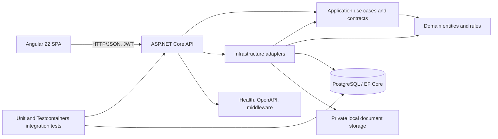
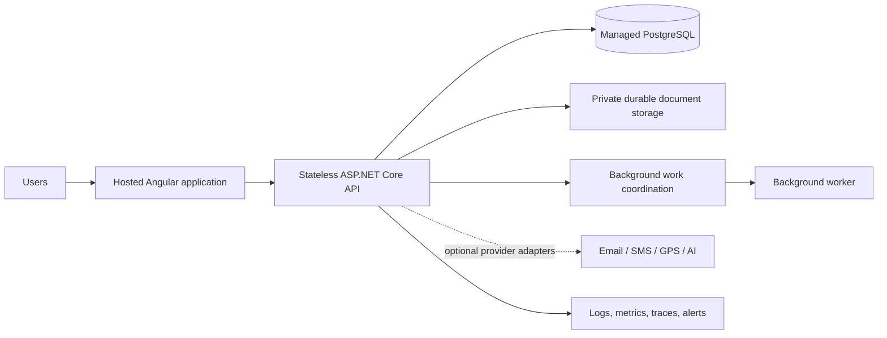

# EthioFleet OS System Architecture

## Current architecture

## Project responsibilities

- **`backend/EthioFleet.Api`** owns HTTP endpoints, authentication/authorization policies, middleware, health checks, and API composition.
- **`backend/EthioFleet.Application`** defines use-case contracts, service interfaces, validation, and result types.
- **`backend/EthioFleet.Domain`** owns entities, value objects, and business invariants without framework dependencies.
- **`backend/EthioFleet.Infrastructure`** implements EF Core persistence, Identity/JWT services, filesystem document storage, reports, and background reminders.
- **`backend/EthioFleet.Tests`** contains domain/audit unit tests and API/database integration tests.
- **`frontend/ethiofleet`** is an Angular 22 shell. It currently has no operational feature routes or API service layer.

## Request and tenant flow

1. The API validates JWT issuer, audience, signature, and lifetime.
2. Role policies require an authenticated user and, for tenant operations, an `organization_id` claim.
3. `CurrentUserContext` exposes user and organization claims to infrastructure services.
4. EF Core query filters constrain tenant-owned data and hide soft-deleted data. SaveChanges stamps audit metadata, assigns the current organization on insert, and rejects cross-organization changes.
5. Composite tenant keys/foreign keys and unique indexes reinforce selected database relationships. These controls do not constitute PostgreSQL row-level security.

## Runtime and configuration

- PostgreSQL 16 is the only container in the current Compose file.
- Connection strings and JWT signing keys are configured through User Secrets/environment configuration; checked-in settings leave them empty.
- CORS origins are explicitly configured. The Angular development shell currently calls the API launch-profile URL `http://localhost:5062`.
- `/health/live` checks process liveness; `/health/ready` includes PostgreSQL readiness.
- OpenAPI and Scalar are exposed only in Development.
- GitHub Actions builds/tests the .NET solution and production-builds the Angular app.

## Production target (not yet implemented)

The target diagram is a direction, not a claim that those services are connected. Add Redis, SignalR, external providers, or separate workers only when a validated product need and deployment model are defined.

## Known architectural gaps

- Frontend has no API base-URL configuration, auth/session service, or feature modules.
- Organization exists as tenant; branch hierarchy and a complete permission model are absent.
- Document storage is local disk and not appropriate for a horizontally scaled deployment.
- No production migration orchestration, secrets-vault configuration, backup/restore runbook, distributed work coordination, or monitoring export is configured.
- GPS and AI provider boundaries are not implemented.

See [DATABASE_DESIGN.md](./DATABASE_DESIGN.md) for persistence details and [API_DOCUMENTATION.md](./API_DOCUMENTATION.md) for current HTTP routes.
